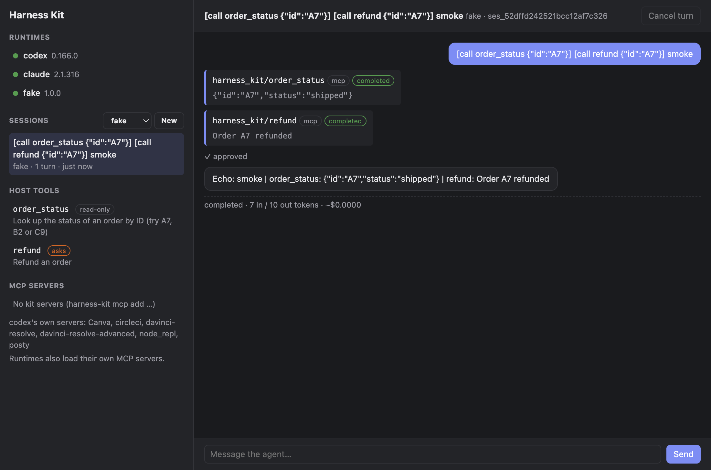

# Harness Kit

Headless, composable primitives for building your own AI agent harness applications.

The standalone SDK spans `core/` for Go packages, local runtime adapters,
CLI/sidecar, and root [`packages/`](../packages) for clients such as
[TypeScript](../packages/client-ts) and [Go](../packages/client-go). Runnable apps live in root
[`examples/`](../examples). You can build and distribute applications
with it independently of the [planned coordination server](../server/README.md),
which has no implementation yet. See the [monorepo overview](../README.md).

Harness Kit does for agent harnesses roughly what Radix does for UI
components: it supplies the infrastructure (runtime discovery, sessions,
event streaming, approvals, process management, a sidecar protocol) and
leaves the agent loop, orchestration, models, tools and interface to you.

It drives locally installed **OpenAI Codex**, **Anthropic Claude Code** and
**ACP agents** through their documented interfaces. CLI adapters use the
runtime's own authentication without reading credential stores; see
[usage policies](docs/runtimes.md#authentication-and-usage-policies).
For applications that own the agent loop, optional OpenAI and Anthropic SDK
modules provide streaming inference with host-supplied API credentials.

```text
Electron ─┐
Wails ────┼─ @tomanagle/harness-kit ── JSON-RPC over stdio ── harness-kit ──┬─ codex app-server
CLI/Node ─┘                                                                 ├─ claude -p (stream-json)
Go apps ──────────────── import the packages directly ──────────────────────┴─ your own adapter
```

- **Composable.** `event`, `permission`, `agent`, `session` and the
  adapters are independent packages.
- **Transport-neutral.** The core never knows whether it is called from
  Go, over RPC or, eventually, from WebAssembly. It builds for
  `wasip1`/`js` today.
- **Zero dependencies in the core.** The Go module in `core/` uses only the standard library. The
  TypeScript client has no runtime dependencies.
- **Safe by default.** Sandbox-disabling options are refused unless the
  host opts in. Approvals deny on timeout. The sidecar exposes typed kit operations.

## Status

The core, sidecar, TypeScript and Go clients, and runtime adapters are tested together.
The kit includes persisted conversations, session updates, branching, archive,
search, tags and live settings. Separate SDK modules support direct inference
and caller-owned context management. Optional worktrees and turn diffs isolate
and inspect changes; usage budgets stop work based on reported consumption.

|                                     | Codex | Claude Code                                                        | fake |
| ----------------------------------- | ----- | ------------------------------------------------------------------ | ---- |
| streaming, cancel, resume, usage    | ✓     | ✓                                                                  | ✓    |
| interactive approvals               | ✓     | ✓ (through the [tool bridge](docs/tools.md#claude-code-approvals)) | ✓    |
| per-session MCP servers, host tools | ✓     | ✓                                                                  | ✓    |

See [session management](docs/sessions.md), [configuration](docs/configuration.md),
[ACP](docs/acp.md), [direct models](docs/models.md) and the
[roadmap](docs/roadmap.md). The [live test report](docs/live-tests.md) records
which lifecycle behavior was verified against the real CLIs.
The [budget guide](docs/budgets.md) explains reporting limits, and the
[workspace guide](docs/workspaces.md) covers isolation and saved diffs.

## Quick start

The commands in this guide run from `core/`, unless stated otherwise:

```sh
git clone https://github.com/tomanagle/harness-kit.git
cd harness-kit/core
make build                         # writes ./bin/harness-kit (core/bin from the repo root)
```

Current Go source uses `github.com/tomanagle/harness-kit/core`. These new module
paths have not been tagged yet, so use a source checkout for this layout.
The existing root-module `v0.2.0` release and npm `@tomanagle/harness-kit@0.2.0`
remain available; moving directories does not publish a new version. See
[migration and release details](docs/releases.md).

### Go: link it directly

Import packages under the new module path, such as
`github.com/tomanagle/harness-kit/core/agent` and
`github.com/tomanagle/harness-kit/core/session`. The source examples already use
these paths.

```go
registry := agent.NewRegistry(codex.New(), claude.New())

mgr := session.NewManager(registry, session.Options{
	Policy: permission.Rules{{Kind: permission.KindCommand, Command: "git status*", Action: permission.ActionAllow}},
})
defer mgr.Shutdown(context.Background())

info, err := mgr.Create(ctx, session.CreateParams{Runtime: "codex", Config: agent.SessionConfig{Cwd: dir}})
if err != nil { /* ... */ }

for ev, err := range mgr.Stream(ctx, info.ID, session.PromptParams{Input: agent.Text("Explain this codebase")}) {
	if d, ok := ev.Data.(event.MessageDeltaData); ok {
		fmt.Print(d.Text)
	}
}
```

Approvals arrive as `approval.requested` events. Answer them with
`mgr.RespondApproval`. A complete terminal harness with interactive
approvals is [examples/cli](../examples/cli/main.go):

```sh
go -C ../examples/cli run . -runtime codex "Explain this codebase"
```

### Go: connect to the sidecar

Use [`packages/client-go`](../packages/client-go/README.md) when a Go application
needs a separate `harness-kit` process. Its module is
`github.com/tomanagle/harness-kit/packages/client-go` (package `harnesskit`), with
no dependency on the core module or third-party libraries. It supports attaching
to streams or spawning a sidecar, typed RPC methods, events, settings updates,
tool callbacks and cancellation. See its README for a complete example and
local-checkout installation instructions while the module is untagged.

Both client packages generate their wire types and methods from the shared
[protocol schema](../protocol/README.md). The CLI's core-domain client lives in
`internal/rpcclient`; applications use the standalone client above.

### Command line

The `harness-kit` binary is also a CLI:

```sh
make install                         # builds and copies it to ~/.local/bin (or: make build → ./bin/harness-kit)

harness-kit runtimes                 # registered runtimes and their capabilities
harness-kit runtimes discover        # installed? which version? signed in?
harness-kit prompt -runtime fake "[approve] hello"      # offline test runtime, no account needed
harness-kit prompt -runtime codex "Summarise this repository"
harness-kit prompt -runtime claude -model haiku "What does main.go do?"
harness-kit chat -runtime codex      # interactive; Ctrl-C cancels a turn, /quit exits

harness-kit sessions                 # every session you ran through Harness Kit, newest first
harness-kit prompt -resume ses_… "and now add tests"   # continue one (runtime and settings come with it)
harness-kit sessions show ses_…      # details; `sessions delete ses_…` forgets one
harness-kit sessions rename ses_… "Add parser tests"   # or name it up front: prompt -title "..."
harness-kit sessions configure ses_… '{"effort":"high"}'   # defaults for subsequent turns
harness-kit prompt -resume ses_… -turn-config '{"effort":"low"}' "Quick explanation" # this turn only
harness-kit sessions --native -runtime codex   # Codex's own history, incl. sessions started in Codex itself
```

The CLI keeps a session history in your user config directory (on macOS
`~/Library/Application Support/harness-kit/sessions`; change it with
`--store DIR` or `HARNESS_KIT_STORE`, or turn it off with `--store memory`).
Each session has a JSON record holding its runtime, runtime session ID, cwd,
settings, title, turn count and last status, plus an append-only
`<sessionId>.events.jsonl` transcript. Prompts, replies, tool activity,
approvals and usage survive restarts and can be replayed with
`session.events`. The runtime still owns the conversation used for resume.
Existing records remain readable; turns from before event persistence was
added cannot be reconstructed by Harness Kit.

| flag                                                             |                                                                                                                             |
| ---------------------------------------------------------------- | --------------------------------------------------------------------------------------------------------------------------- |
| `-runtime codex\|claude\|fake`                                   | which runtime (default `codex`)                                                                                             |
| `-cwd DIR`, `-model NAME`, `-effort LEVEL`, `-instructions TEXT` | session settings; explicit `-model`/`-effort` with `-resume ses_…` update future defaults                                   |
| `-turn-config JSON`                                              | overrides for each prompt without changing defaults, e.g. `'{"effort":"high"}'`                                             |
| `-title TEXT`                                                    | name the session (default: the start of the first prompt); with `-resume ses_…`, renames it                                 |
| `-resume ID`                                                     | continue a session: a `ses_…` ID from `harness-kit sessions`, or a runtime-native ID together with `-runtime`               |
| `-options JSON`                                                  | runtime options, e.g. `'{"sandbox":"read-only"}'` or `'{"permissionMode":"acceptEdits"}'` ([all options](docs/runtimes.md)) |
| `-approve ask\|allow\|deny`                                      | how approvals are answered (default `ask`; `deny` when there's no terminal)                                                 |
| `-rpc`                                                           | run through a sidecar over JSON-RPC instead of in-process, to test the protocol path                                        |

In `chat`, `/configure {"effort":"high"}` changes subsequent turns. A
configuration patch preserves omitted fields; `{"reset":["effort"]}`
returns the session to its creation setting. Supported settings and their
lifetimes are advertised in `runtimes --json` output. The host controls configuration
sources and policy; see [configuration](docs/configuration.md).

Output, for every command:

| flag                                 | prints                                                                                                                   |
| ------------------------------------ | ------------------------------------------------------------------------------------------------------------------------ |
| `--output text` (default)            | readable output; for prompts, the reply on stdout and progress on stderr                                                 |
| `--output json`, `--json`, `-o json` | one JSON document; for prompts, the final result: `status`, `text`, `usage`, `error`, `runtimeSessionId` (for `-resume`) |
| `--output stream-json`               | prompt and chat: every event as a JSON line, the same events the sidecar sends                                           |

```sh
harness-kit runtimes discover --json
harness-kit prompt -runtime claude -model haiku --json "What does main.go do?" | jq -r .text
git diff | harness-kit prompt -runtime codex --output stream-json
```

Exit status is 0 for completed, 1 for failed and 130 for cancelled turns.

**Running from a checkout without installing:** `./hk <command> [flags]`
works from either the repository root or `core/`, rebuilds `core/bin/harness-kit`
if needed, and runs the CLI, e.g. `./hk runtimes discover --json`.
`make run ARGS="runtimes discover --json"` also works, but everything for
harness-kit must go inside `ARGS="..."`, because `make` treats dashed
arguments as its own options.

### MCP servers: define once, every runtime

```sh
harness-kit mcp add github --env GITHUB_TOKEN -- npx -y @modelcontextprotocol/server-github
harness-kit mcp add docs --url https://mcp.example.com/mcp --bearer-env DOCS_TOKEN
harness-kit mcp test                 # start each server and list its tools
harness-kit mcp                      # what loads, from where; project files need `harness-kit mcp trust`
```

Servers in your user config, in a project's `harness-kit.json`, or passed
for one session (`--mcp FILE`, or `mcp` in `session.create`) are translated
for each runtime: Codex gets per-thread `mcp_servers`, Claude Code gets
`--mcp-config`. Neither runtime's own config files are touched, and secrets
stay as `${VAR}` references. The runtime's native servers keep loading
unless you pass `--no-native-mcp`. Details: [docs/mcp.md](docs/mcp.md).

### Host tools: your app's functions, callable by any runtime

```ts
await kit.tools.register({
  name: "create_ticket",
  inputSchema: { type: "object", properties: { title: { type: "string" } }, required: ["title"] },
  approval: "ask",
  handler: async ({ title }) => tickets.create(title),
});
```

The handler runs in your process. Codex and Claude Code reach it through an
MCP server that Harness Kit hosts for each session, relayed over a private
local socket (no network port). The same bridge gives **Claude Code
interactive approvals**: its permission prompts become `approval.requested`
events. Details: [docs/tools.md](docs/tools.md).

### Sidecar: any language, any app

The sidecar is a local application process using stdio. The future server for
coordinating sessions across devices is a separate planned product.

```sh
harness-kit serve                    # JSON-RPC on stdin/stdout (what Electron/Wails spawn)
harness-kit serve --settings ./settings.json # one settings document; live changes via settings.configure
```

The shared settings document covers memory/cache policy, history pages, stream
buffers, logging, approvals, startup wiring and session defaults. Applications
can build a settings UI around `settings.get` / `settings.configure` and receive
revisioned `settings.updated` notifications. Memory policy changes apply while
the sidecar runs; fields requiring a new session or restart advertise that
lifetime. See [configuration](docs/configuration.md#one-settings-document).

### TypeScript (Electron main, Node, or any Transport)

The published package name remains `@tomanagle/harness-kit`. When developing
against this checkout, the client source is in root `packages/client-ts`
(`../packages/client-ts` from `core/`); the
following binary path assumes the working directory is `core/`.

```ts
import { createHarnessKit } from "@tomanagle/harness-kit";
import { stdio } from "@tomanagle/harness-kit/node";

const kit = await createHarnessKit({ transport: stdio({ command: "./bin/harness-kit" }) });

const runtimes = await kit.runtimes.discover();
const session = await kit.sessions.create({ runtime: "codex", cwd: process.cwd() });

for await (const event of session.prompt("Explain this codebase")) {
  if (event.type === "message.delta") process.stdout.write(event.data.text);
  if (event.type === "approval.requested")
    await kit.approvals.respond(event.data.approvalId, "allow");
}
// Update defaults, then override one prompt without changing those defaults.
await session.configure({ effort: "high" });
for await (const event of session.prompt("Briefly summarize", { config: { effort: "low" } })) {
  if (event.type === "message.delta") process.stdout.write(event.data.text);
  if (event.type === "approval.requested")
    await kit.approvals.respond(event.data.approvalId, "allow");
}
await kit.close();
```

The root entry point has no Node dependencies. In a browser, Electron
renderer or Wails frontend, pass a `callbackTransport` over your own
channel instead of `stdio`.

Examples live at repository-root `examples/`, outside the core module. The Go
CLI is a standalone module in `examples/cli`, with a local replacement pointing
to `../../core`. Its module identity is
`github.com/tomanagle/harness-kit/examples/cli`; the model and Wails examples use
`github.com/tomanagle/harness-kit/examples/model` and
`github.com/tomanagle/harness-kit/examples/wails` respectively. From the repository
root, run the CLI with `go -C examples/cli run .`; from `core/`, use
`go -C ../examples/cli run .` as shown above.

Use `make example` to list targets, then `make example <name>` (or
`make example-<name>`) from either the repository root or `core/`.
These targets default to the offline fake runtime; add
`RUNTIME=codex` or `RUNTIME=claude` to use a real one, and `PROMPT="..."`
for `cli` and `node`.

```sh
make example overview                 # runtimes, your sessions, host tools, MCP servers (JSON=1 for JSON)
make example electron                 # dashboard app: the same lists, plus chat, tool calls and approvals
make example wails                    # the same dashboard in Wails (HARNESS_KIT_MODE=direct: in-process Go)
make example cli                      # interactive chat, linked in-process
make example node PROMPT="hi"         # Node.js through the sidecar
make example tools RUNTIME=codex      # host tools registered from Node, with an approval
make example-electron-smoke           # Electron with a hidden window, driven end to end
```



The Electron and Wails apps share one dashboard
([examples/ui](../examples/ui)): runtimes with their status, your sessions
(click one to reopen it), the registered host tools, the kit and native MCP
servers, and a chat pane that shows tool calls and asks for approvals.
Rename a session with the header's Rename button or by double-clicking its
title. Saved transcripts open without starting a runtime; sending the next
prompt resumes it. Title and lifecycle changes update connected clients
through `session.updated`.

The optional source-control panel shows repository status, working and staged
diffs, branches and history. Explicit actions stage, unstage, commit, switch
branches, fetch, pull and push through the same generated client APIs. The
harness controls the workflow; [Git settings](docs/git.md) apply at runtime.

| Example                                                   | Shows                                                                                                                 |
| --------------------------------------------------------- | --------------------------------------------------------------------------------------------------------------------- |
| [examples/cli](../examples/cli)                           | A minimal harness of your own: about 150 lines linking the Go packages                                                |
| [examples/node](../examples/node)                         | Node.js sidecar client (the Electron main-process code path), and `tools.ts`: host tools with approvals               |
| [examples/ui](../examples/ui)                             | The dashboard shared by Electron and Wails, written against one small API (`api.js`)                                  |
| [examples/electron](../examples/electron)                 | Electron app; the main process mediates typed IPC (the renderer never sees raw RPC) and registers the demo tools      |
| [examples/wails](../examples/wails)                       | Wails app: sidecar mode with the _same_ TS client (tools registered in the webview), or in-process mode with Go tools |
| [examples/node/overview.ts](../examples/node/overview.ts) | Everything at a glance from Node.js; `--json` for one document                                                        |

## Documentation

- [Architecture](docs/architecture.md): proposal review, package
  boundaries, interfaces, trade-offs
- [Protocol](docs/protocol.md): framing, methods, events, ordering,
  backpressure, errors, lifecycle
- [Configuration](docs/configuration.md): host setup, session defaults, per-turn
  overrides, inheritance, and supported setting lifetimes
- [Git integration](docs/git.md): optional source-control APIs, live policy and native adapters
- [Workspaces](docs/workspaces.md): isolated worktrees and saved turn diffs
- [Package boundaries](docs/packages.md): public building blocks and internal implementation
- [Runtimes](docs/runtimes.md): Codex and Claude Code integration, usage
  policies, options, writing adapters
- [MCP](docs/mcp.md): one MCP config for every runtime; layers, format, trust
- [Host tools](docs/tools.md): register your app's functions; the MCP bridge; Claude Code approvals
- [Security](docs/security.md): trust boundaries and safe defaults
- [Roadmap](docs/roadmap.md): implementation plan

## Development

```sh
make test        # default offline test suite
make generate    # refresh protocol schema and TypeScript/Go client contracts
make check-generated # fail if generated files are stale (also checked in CI)
make test-clients # TypeScript and standalone Go client tests
make lint        # gofmt + go vet
make wasm-check  # the core must build for WebAssembly and never spawn processes
make cross       # build the sidecar for macOS, Linux and Windows
make test-live   # real Codex/Claude CLIs; uses a little of your quota
make test-providers # isolated SDK adapters, using local test servers
make test-examples # separate Go example modules at repository-root examples/
make install     # put the harness-kit CLI on your PATH (INSTALL_DIR=~/.local/bin)
```

Requires Go 1.24+ and Node 22.18+ (the TS tests run TypeScript directly).
The optional OpenAI provider module and direct-model example require Go 1.26+.
See [Models and context](docs/models.md) for building your own agent loop, and
[ACP](docs/acp.md) for connecting additional agents.

For npm publishing and the exact trusted publisher configuration, see
[Releases](docs/releases.md).

## Layout

The SDK consists of `core/` and root `packages/`. Repository workflows remain in
[`.github/workflows`](../.github/workflows). Paths in this tree start at the
repository root:

```text
core/
  agent/            AgentRuntime interface, registry, discovery
  event/            event model, per-session log, non-blocking bus
  permission/       approval requests, policies, broker
  session/          session manager and store
  internal/         CLI, generator, RPC dispatch, accounting and process supervision
  rpc/              public protocol types and server integration
  runtimes/         codex, claude, acp, fake adapters
  model/            dependency-free streaming inference contract
    contextwindow/  public caller-owned history and compaction
  config/           public configuration and budget policy types
  settings/         one startup/runtime settings document
  hooks/            injectable lifecycle extensions
  logging/          bounded slog stream for applications and UIs
  workspace/        portable workspace contract and native Git backend
  providers/        optional OpenAI and Anthropic SDK modules
  cmd/harness-kit/  small local CLI/sidecar entry point
  cmd/protocolgen/  small schema/client generator entry point
  docs/             SDK documentation
  bin/              local build output
packages/
  client-ts/        @tomanagle/harness-kit
  client-go/        standalone Go sidecar client
protocol/           generated schema and generation guide
examples/           cli, model, node, electron, wails and shared dashboard
server/             planned coordination server; placeholder only
.github/workflows/  repository CI and release workflows
```

See [package boundaries](docs/packages.md) for what builders can import and
the research behind the layout, dependency checks, and compatibility notes.

## License

[MIT](../LICENSE)
